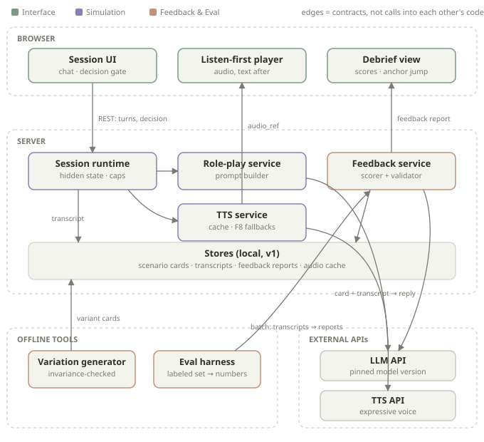

# Lumi — System Design (short)

_Companion to `lumi-prd.md` / `lumi-roadmap-v3.md`. One diagram, one table, and the
model consistency policy. Contracts (repo `shared/contracts/`) are the only
interfaces between lanes._

> **v1 status (2026-07-13):** matches implementation except the voice path —
> voice-out was descoped 7/13, so the TTS service/cache and listen-first player
> shown here (and in the diagram) are design-complete but not built. The voice
> seam survives in code: every reply turn is created with `audio_ref: null` at a
> single point in the session engine.

## Architecture

## Components

| Component | Lane | Responsibility | Talks via |
|---|---|---|---|
| Session UI / debrief | Interface | Everything the trainee sees; anchor-jump debrief; blind session start (no scenario visible pre-debrief) | REST + transcript/report contracts |
| Session runtime | Simulation | Hidden state, turn loop, decision gate, caps, transcript assembly | scenario card in, transcript out |
| Role-play service | Simulation | Builds the traveler prompt per turn; calls LLM | card + transcript window → LLM |
| TTS service + cache _[descoped v1]_ | Simulation | Per-turn speech honoring `voice_direction`; cache keyed (text, direction); F8 fallbacks | text → audio_ref |
| Feedback service | F&E | Scorer + anchor-validity gate (regenerate on fail) | transcript + card + rubric → report |
| Variation generator | F&E (offline) | Archetype → variant cards; invariance-checked | cards → store |
| Eval harness | F&E (offline) | Labeled set → scorer → agreement + per-dimension precision/recall; AC1/AC5 hard gates; live role-play suite (never-reveal, in-character, differential) | batch reports |
| Stores | shared | Scenario cards, transcripts, reports, audio — all local files/db in v1 | the three contracts |

## Data at rest

Scenario cards (authored + generated), transcripts, feedback reports (all
contract-validated JSON), labeled set with reference labels; audio cache deferred
with voice. All local in v1 (privacy requirement: trainee data never leaves the
machine except as prompt context to the model APIs; with local Ollama, nothing
leaves the machine at all).

## Model calls (complete inventory)

| Call | When | Model (v1 actual) | Temp | Output guard |
|---|---|---|---|---|
| Role-play turn | online, per turn | Groq `llama-3.3-70b-versatile` (pinned via env; local Ollama or fixture as fallbacks) | 0.8 | json-mode output; never-reveal regex guard with one corrective retry; up to 4 attempts with Retry-After backoff, then a retryable 503 to the trainee (turn rolled back — no silent fixture substitution); prompt version in every trace |
| Feedback report | per session end | **no model call in v1** — rule-based scorer (transcript + card + rubric → report) | — | JSON schema + anchor validator + AC5 modeled-alternatives gate; LLM scorer is the planned escalation if agreement stalls on real transcripts |
| Variation generation | offline batch | same provider chain as role-play | 1.0 | schema (ajv) + invariance check + title-leak gate; human read before shipping |
| Reference labels | offline | hand-crafted + team-reviewed (two labels corrected during review) | — | AC2 review step |
| TTS _[descoped v1]_ | — | — | — | design retained (cache + 5 F8 fallback paths) |

## Tradeoffs (discussed, decided, revisitable)

1. **Latency vs. accuracy vs. build time (model choice).** Frontier-small API
   (Flash-class): ~1–1.5s per traveler reply, best sustained instruction-following,
   zero build time. Self-hosted 7–8B: ~300–500ms on a good GPU but weakest exactly
   where we're exposed (holding character 25 turns, never leaking under pressure) and
   days of building time/ops. Open models on fast inference providers (Groq-class:
   sub-200ms TTFT, 300+ tok/s) sit between — no ops, sub-second, mid accuracy.
   **Originally chosen: Flash-class API. Revised in build (7/12): Groq
   Llama-3.3-70B** — Gemini's free-tier rate limits (~5 req/min, 12k TPM equiv.)
   made iteration impossible, and the revisit trigger fired exactly as designed:
   the Groq candidate passed the differential-behavior probe and the never-reveal
   suite (10/10 adversarial turns) before adoption. Local Ollama added as the $0
   offline lane; the provider seam makes any OpenAI-compatible host a config
   change. Residual limitation, accepted for the hackathon: free-tier
   token-per-minute caps can briefly rate-limit a live turn (surfaced to the
   trainee as a visible retry, never a canned substitute); a paid key to a
   higher-tier model removes the ceiling with zero code changes.
2. **Scorer accuracy vs. scorer cost/speed.** The debrief has a 30s budget, not a
   2s one — so the scorer can use a stronger, slower model than the traveler if
   agreement stalls below 80%. A build-time-free accuracy lever; costs stay in
   pennies. Start Flash, escalate on eval evidence.
3. **Generated variation scale vs. content control.** The generator buys
   replayability and an eval test set; risks subtle ground-truth corruption.
   Mitigations: invariance checker on every variant + human spot-checks;
   hand-authored variants as fallback.
4. _[deferred with voice]_ **Cached TTS vs. freshness.** Cache keyed on (text, voice_direction) kills the
   main dev-cost risk and makes demos deterministic; identical lines sound identical
   across sessions — acceptable since variations change the words anyway.
